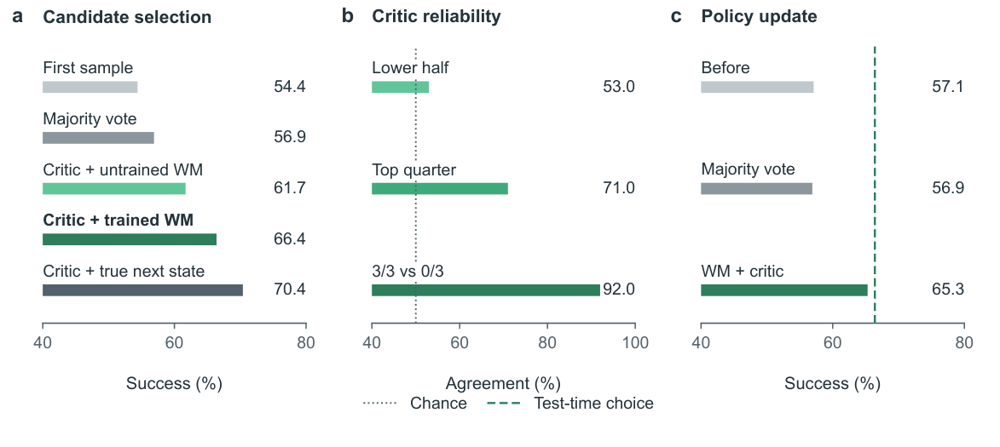
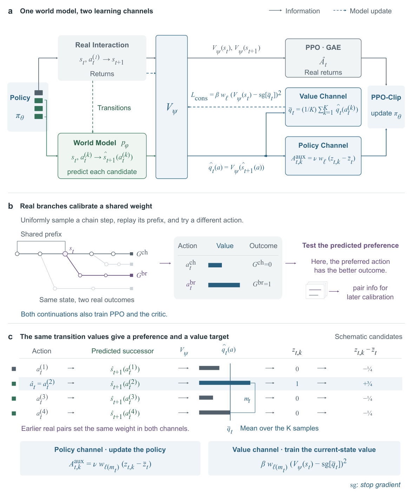
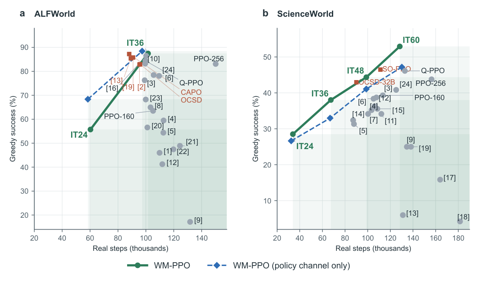
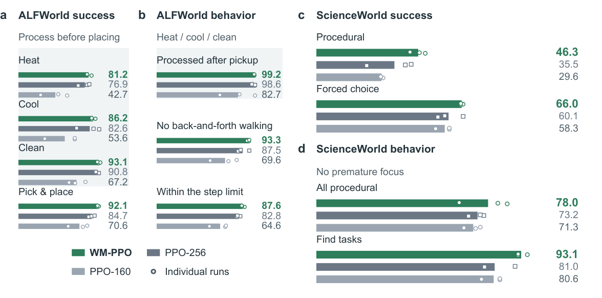
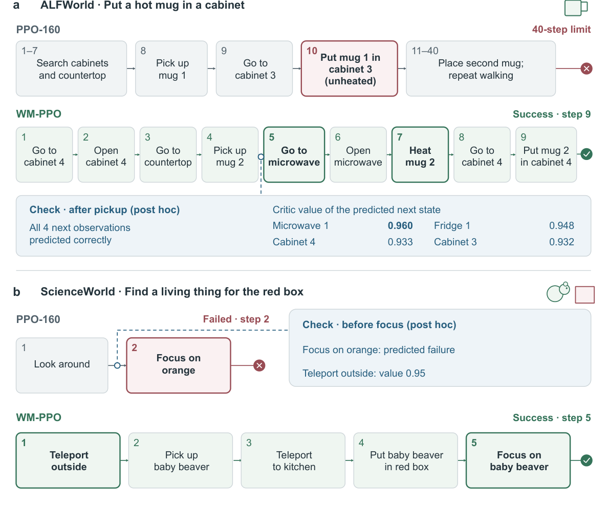
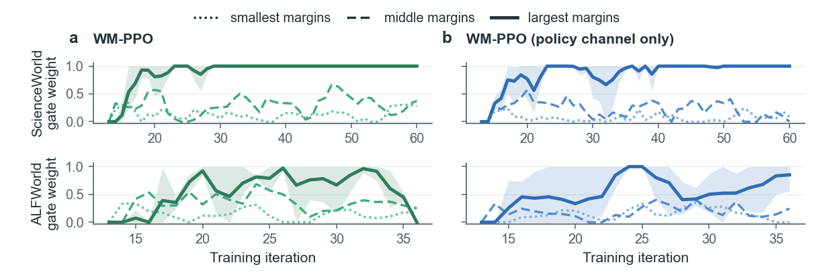
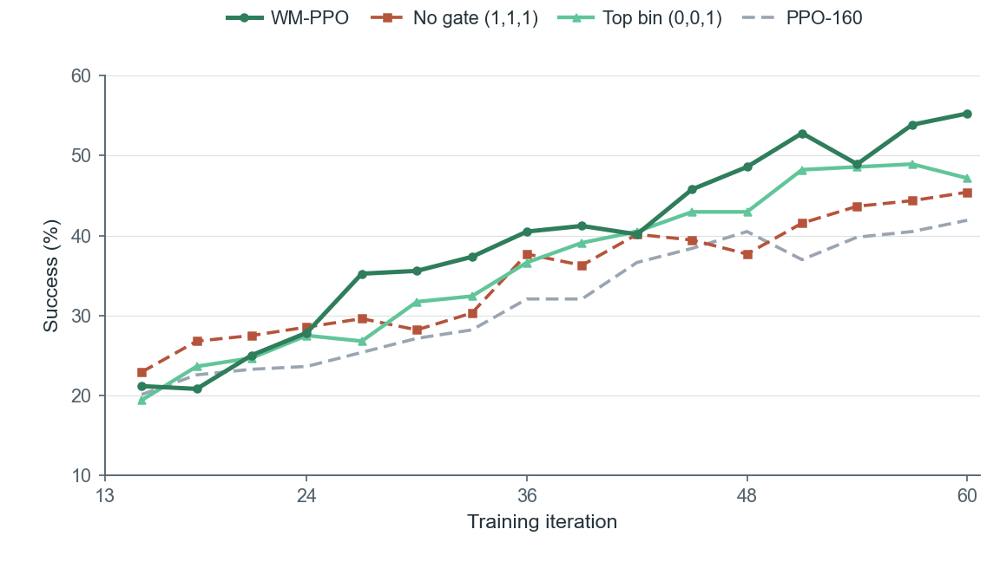

<div align="center">

# Learning to Act with World Models by Valuing What Comes Next

### WM-PPO: Learning from the value of predicted state transitions

**Chenghao Gao<sup>1,\*</sup> · Zhi Zhang<sup>2,\*</sup> · Dian Jin<sup>1</sup> · Yihe Pan<sup>3</sup> · Doudou Zhou<sup>1,†</sup>**

<sup>1</sup> National University of Singapore · <sup>2</sup> University of California, Los Angeles · <sup>3</sup> Fudan University  
<sup>\*</sup> Equal contribution · <sup>†</sup> Corresponding author

[**📄 Paper (arXiv)**](https://arxiv.org/abs/2611.12200) · [**📑 PDF**](https://arxiv.org/pdf/2611.12200) · [**🤗 Checkpoints**](https://huggingface.co/nuskonghou/wm-ppo) · [**⚡ Quick start**](#quick-start)

</div>

**A sparse terminal reward tells an agent whether it succeeded. The environment's transitions contain information about how each action changed its chances of succeeding.**

WM-PPO learns to use that information. A world model, trained on **real transitions**, predicts what the policy's candidate actions would change. PPO's existing critic, trained primarily on **real returns**, values the predicted successor states according to the current policy's probability of eventual success. Those *transition values* then inform both policy and critic learning, with their reliability calibrated against real branch outcomes.

**Only the policy is needed at inference. No teacher model or privileged environment information is used.**

---

## Why value what comes next?

An agent may find a plate, pick it up, and put it in a cabinet—without first cleaning it. The binary terminal reward says **failure**. It does not tell the agent which earlier decision mattered, or what an unexecuted alternative might have made possible.

Yet the environment records changes along the way. Some are consequential; some are not. A long new observation might simply enumerate irrelevant objects, while a short confirmation that a mug has been heated could satisfy a critical prerequisite.

**Predicting an observation is not the same as knowing whether the action helps.** Its importance depends on the goal and what the *current policy* can still accomplish from the resulting state. For binary terminal rewards and undiscounted returns,

$$
V^\pi(s)=\Pr_\pi(\mathrm{success}\mid s),\quad
Q^\pi(s,a)=\mathbb E[V^\pi(s')\mid s,a].
$$

A transition's contribution is reflected by the change in success probability, rather than by the surface magnitude of the observation change. WM-PPO combines predicted consequences with the existing critic's task-dependent valuation.

## Three diagnostic questions, before proposing the method

We first test the premise on ALFWorld. These are **diagnostics with a fixed policy**, not the final online WM-PPO training algorithm.



*Figure 1, from the paper. (a) Candidate selection; (b) value-ranking reliability; (c) learning from consequence-based candidate preferences.*

1. **Can the critic value real successors?** Selecting the best of four sampled actions using the true successor's critic value achieves **70.4%** success, versus **56.9%** for majority vote.
2. **Do world-model predictions preserve useful differences?** Selecting with a *trained* world model and the critic reaches **66.4%** success. Predicted consequences therefore recover a substantial part of the signal available from real successors.
3. **Can those comparisons improve the policy itself?** In a separate one-epoch, reward-free diagnostic update using preference labels from the world model and critic, policy-only success rises from **57.1% to 65.3%**. At evaluation, the policy acts without either model.

A crucial qualification: comparisons are **not equally reliable**. Larger value margins tend to be more informative, motivating calibration from real outcomes rather than unconditional trust in predictions.

## WM-PPO: One world model, two learning channels



*Figure 2, from the paper. The policy's sampled alternatives are predicted and valued; real branches calibrate how strongly both learning channels are used.*

At a state reached during training, the policy samples **K candidate actions** and executes its **first** sample, preserving the behavior policy. For each distinct candidate, a world model predicts one next observation. The critic evaluates the resulting predicted successor:

$$
\widehat q_t(a)=V_\psi\!\left(\widehat s_{t+1}(a)\right),
$$

with terminal outcomes handled explicitly. The same set of transition values supports two complementary updates:

| Learning channel | What it learns from predicted transitions | Where the signal enters |
|:--|:--|:--|
| **Policy channel** | Which of the policy's sampled actions leads to the more valuable predicted successor | Auxiliary candidate preferences/advantages in PPO's clipped policy objective |
| **Value channel** | How valuable the current state is under the policy's **own candidate distribution** | Mean transition value as a one-step auxiliary target for the critic, in addition to real returns |

### Reliability from real outcomes

The world model can be wrong, and the critic's rankings can be biased. Each training task therefore includes a real main episode (the *chain*) and three real branches that try alternative actions from earlier states. Previous chain–branch outcomes determine a **shared, margin-dependent gate**, which weights both channels according to how useful similarly sized predicted preferences have been in real interactions.

The gate does **not** replace the terminal reward, and predicted observations do **not** become fictitious returns. The critic's main supervision remains real returns; the world model is trained on real observed transitions. The additional computation is confined to training.

## Evidence: better learning from comparable real interaction

All numbers below are **greedy, policy-only success rates** on the paper's evaluation games (means over three runs for the primary methods). Checkpoints and budgets follow the evaluation protocol in the paper.

| Environment | PPO-160 | WM-PPO | Improvement |
|:--|--:|--:|--:|
| **ALFWorld** | 63.5% | **87.5%** | **+24.0 pp** |
| **ScienceWorld** | 39.3% | **52.9%** | **+13.6 pp** |

The policy-channel-only variant reaches **88.4%** on ALFWorld and **47.2%** on ScienceWorld. On the more procedural ScienceWorld, adding the value channel raises greedy success to **52.9%**. The full method exceeds the strongest tested PPO refinement on ScienceWorld (SO-PPO, 46.5%) by **6.5 percentage points**, while the strongest PPO refinements are much closer to WM-PPO on ALFWorld.



*Figure 4, from the paper. Greedy success versus actual environment steps; learning from predicted alternatives trades additional training computation for more information from real interactions.*

These improvements are not simply explained by collecting larger real trees: **Wide-Tree-PPO**, which retains the branches but removes the auxiliary policy update, reaches **40.8%** on ScienceWorld. The controls also examine direct learned Q-values, fixed world models, and several forms of auxiliary supervision. See Sections 4–5 for complete comparisons, real-step accounting, and significance tests.

## What changes in the learned behavior?

The most revealing outcomes are not only the final scores: the learned policy more often **completes prerequisites before committing**.



*Figure 10, from the paper. The gains are particularly pronounced on tasks that require intermediate processing or conditions.*



*Figure 11, from the paper. In ALFWorld, WM-PPO heats a mug before placing it in a cabinet; in ScienceWorld, it fulfills the needed conditions before committing to an answer. These are illustrative evaluation trajectories, not claims that every episode follows these paths.*

On procedural ScienceWorld tasks, WM-PPO reaches **46.3%** greedy success compared with **29.6%** for PPO-160. On ALFWorld, it more often carries out heating, cooling, or cleaning before placing an object. This behavior connects the transition-value comparisons to a concrete long-horizon decision problem: recognizing when an action changes what remains achievable.

## Why the reliability gate matters

Predicted comparisons are **not equally reliable**. Late in ScienceWorld training, the preferred action has the better real outcome in **84%** of branch pairs with different outcomes in the largest margin bin, while the smaller bins are close to chance. A single gate therefore decides when, and how much, these comparisons shape both networks: the same weight scales the policy's auxiliary advantages and the critic's auxiliary loss, and each margin bin earns its weight from the realized gain of its earlier comparisons.



*Figure 8, from the paper. Gate weights of the smallest, middle and largest margin bins during training, for WM-PPO (a) and its policy-channel-only variant (b); means over three runs. Top: ScienceWorld; bottom: ALFWorld.*

On ScienceWorld, the gate starts closed and opens as the critic and world model become reliable. The largest bin reaches full weight early and keeps it; the smaller bins, close to chance but with a slightly positive gain, stay at low weights, so their weak signal enters both channels without dominating them. The value channel feeds this calibration: with more reliable comparisons, WM-PPO's largest bin opens earlier and stays open, its critic fits real returns better late in training (explained variance 0.49 against 0.30 with the policy channel only), and it pulls ahead of the policy-channel-only variant from iteration 36 onward. On ALFWorld, the same calibration withdraws feedback as success approaches the ceiling.

<p align="center"></p>

*Figure 9, from the paper. Gate ablation on ScienceWorld (first run of each method). Two copies of WM-PPO fix the bin weights from iteration 13 at (1, 1, 1) (no gate) or (0, 0, 1) (largest-margin bin only) in both channels; all other settings are unchanged.*

Fixing the weights shows what this calibration contributes. **Full weight** rises fastest at first, but the near-chance preferences of the smaller bins keep entering at the same weight as the reliable ones, and its success later grows no faster than PPO-160's. **Keeping only the largest bin** is stable but stays below WM-PPO: it never receives the weak signal of the smaller bins, and it trusts the largest bin before its comparisons have proven reliable. Both copies end significantly below WM-PPO, ordered by the reliability of the margin bins.

The predicted valuations are **not** universally correct. The method learns when comparison signals deserve weight, and the value channel can improve the critic that supplies those comparisons. This is why the two channels and their shared calibration are central to the method, not decorative add-ons.

For the full proof-of-concept diagnostics, the online training algorithm, budget accounting, ablations, and limitations, see [the paper](https://arxiv.org/abs/2611.12200).

---

## Quick start

This repository holds the code, the configuration of every reported method and the per-game evaluation data of the
paper. Two Docker images, the base model and the checkpoints are needed. Setup is under [Installation](#installation);
the checkpoints are on Hugging Face, [nuskonghou/wm-ppo](https://huggingface.co/nuskonghou/wm-ppo), and described in
[WEIGHTS.md](WEIGHTS.md).

**1. Evaluate the released checkpoints** (1 GPU; about 1 h on ALFWorld and 2 h on ScienceWorld)

```bash
scripts/wmppo data alfworld                                    # once: the ALFWorld games
scripts/wmppo eval alfworld weights/alfworld/wmppo_run1_it036/policy wmppo_run1_it036 --gpu 0
python3 analysis/score_eval.py alfworld wmppo_run1_it036       # compares with the official evaluation
scripts/wmppo eval scienceworld weights/scienceworld/wmppo_run1_it060/policy wmppo_run1_it060 --gpu 0
python3 analysis/score_eval.py scienceworld wmppo_run1_it060
```

**2. Check the paper's numbers from the released evaluation data** (CPU, Python 3 standard library)

```bash
python3 analysis/check_tables.py       # recomputes Tables 2, 7, 8, 10-13, 15-18, 21: "total: 981/981 cells match"
python3 analysis/diagnostics.py        # Section 2 and Figure 1
```

**3. Train WM-PPO from the shared warm-up** (7 GPUs; one iteration takes about 40 min on ALFWorld)

```bash
mkdir -p alfworld/runs/wm
cp -r weights/alfworld/warmup alfworld/runs/ppo                # the warm-up every method starts from
cp -r weights/alfworld/initial_wm alfworld/runs/wm/warmup_log  # the initial world model
scripts/wmppo train alfworld wmppo --run 1 --evaluate          # iterations 13-55, then the evaluation protocol
```

## Released checkpoints

The checkpoints are those of WM-PPO **run 1 (seed 1)** in each environment: policy, critic and world model at the
iteration of the main results, plus the shared warm-up and the initial world model. As in the paper, run k is the run
with the k-th seed; the paper reports three runs on ALFWorld and ScienceWorld, and the results of every run are in its
Table 15.

| Environment | Checkpoint | Greedy | pass@1 | pass@3 | Paper, mean ± SD of three runs (greedy / pass@1) |
|---|---|---|---|---|---|
| ALFWorld (274 games) | run 1, iteration 36 | 88.3 | 89.7 | 95.3 | 87.5 ± 0.9 / 87.8 ± 1.7 |
| ScienceWorld (284 variations) | run 1, iteration 60 | 54.9 | 56.5 | 65.5 | 52.9 ± 2.3 / 51.6 ± 4.8 |
| Text Sokoban (300 levels) | the single run, iteration 36 | 87.0 | 84.4 | -- | one run (Table 18) |

Greedy decoding on the inference server is not bit-exact, so a repeated evaluation can differ from the official one on a
few games.

## Repository layout

| Path | Content |
|---|---|
| `alfworld/`, `scienceworld/`, `sokoban/` | training loop (`alf_final.py`), rollouts, environments, prompts, trainers, evaluation scripts; ALFWorld also has the Section 2 diagnostics |
| `wmppo/paths.py` | every machine-specific location (base model, data, images), each overridable by an environment variable |
| `configs/<env>/<method>.yaml` | one file per reported method: arguments, paper run → `--seed`, GPU layout, evaluated iterations |
| `scripts/wmppo` | entry point: runs `scripts/launch.py` in the environment image |
| `scripts/launch.py` | inference servers, training, warm-up, initial world model, evaluation protocol |
| `scripts/export_weights.sh` | collects checkpoints from run directories into a release layout with checksums |
| `docker/` | the two images and the pinned Python packages |
| `results/` | per-game official evaluations of every reported run, training curves, gate logs, diagnostics, the paper's tables ([results/README.md](results/README.md)) |
| `analysis/` | table check, figures, Section 2 numbers, scoring of new evaluations |
| `docs/REPRODUCE.md` | each table and figure: data, command, configs |
| `docs/index.html`, `docs/assets/` | project page and the paper figures shown in this README |
| `tests/` | CPU tests |

## Installation

The host needs Linux, NVIDIA GPUs, Docker with the NVIDIA Container Toolkit, and Python 3 for `analysis/`
(`pip install -r analysis/requirements.txt` for the figures and the tests). The paper's runs used A100 40GB nodes
(two early segments of two baseline runs ran on H100 nodes).

```bash
docker build -t wmppo-trainer -f docker/Dockerfile.trainer docker   # sglang + PyTorch + peft: servers and trainers
docker build -t wmppo-env -f docker/Dockerfile.env docker           # ALFWorld, ScienceWorld (Java 11), Sokoban
hf download Qwen/Qwen3-4B-Instruct-2507 --local-dir models/Qwen3-4B-Instruct-2507   # hf: pip install huggingface_hub
hf download nuskonghou/wm-ppo --local-dir weights                                   # checkpoints, about 9.5 GB
```

- `wmppo-trainer` is the `slimerl/slime` image of all runs in the paper, pinned by digest (public tag
  `slimerl/slime:nightly-dev-20260707a`), with peft 0.21.2.
- `wmppo-env` is Ubuntu 22.04 with Python 3.10, Java 11 and the packages of `docker/requirements-*.txt` (ALFWorld and
  Sokoban share one environment, ScienceWorld has its own).
- `scripts/wmppo` runs the launcher in `wmppo-env` with the Docker socket mounted; the launcher starts every inference
  server and trainer as a sibling container of `wmppo-trainer`. Directories are mounted at the same absolute paths in all
  containers.

Locations, all optional:

| Variable | Default | Meaning |
|---|---|---|
| `WMPPO_MODEL` | `models/Qwen3-4B-Instruct-2507` | base model directory |
| `ALFWORLD_DATA` | `data/alfworld` | ALFWorld data (holds `json_2.1.1/`) |
| `WMPPO_GPUS` | `0,1,2,3,4,5,6,7` | GPUs the launcher assigns, in order |
| `WMPPO_TMP` | `/tmp` | temporary files of the environment workers (the ALFWorld planner writes many) |
| `WMPPO_TEACHER_MODEL` | `<models>/Qwen3-32B` | teacher of the OCSD (32B) and OPD (32B) baselines |
| `WMPPO_MOUNTS` | | extra host directories for the containers, colon-separated |

## Data

- **ALFWorld**: `scripts/wmppo data alfworld` runs `alfworld-download` into `ALFWORLD_DATA`. Training uses the 3,553
  `train` games; evaluation pools the 140 seen-room (`valid_seen`) and 134 unseen-room (`valid_unseen`) games.
- **ScienceWorld**: the simulator ships with the `scienceworld` package (1.2.3). The 18 tasks, the training variations
  and the 284 evaluation variations (dev 140, test 144) are defined in `scienceworld/env.py`.
- **Text Sokoban**: 6x6 levels with one box and at most 15 steps, generated from seeds; `sokoban/data/levels.json` holds
  the seeds of the 18,908 training and the 300 held-out evaluation levels.

## Training

```bash
scripts/wmppo train ENV METHOD [--run K] [--evaluate] [--iters N]
```

- `configs/ENV/METHOD.yaml` holds the arguments of the reported runs; `runs` maps paper run K to `--seed`.
- Every method starts from the shared 12-iteration warm-up (`ENV/runs/ppo`, task cursor included), so all methods see
  the same tasks from iteration 13 on. Methods with a world model start from the initial world model
  (`ENV/runs/wm/warmup_log`). Copy both from the checkpoints as in the quick start, or retrain them (below).
- Output: `ENV/runs/METHOD_runK/` with `itNNN/{adapter,critic,wm}`, the trees and statistics of each iteration,
  `metrics.jsonl`, and greedy evaluations every three iterations (`eval_NNN.json`). An interrupted run resumes when the
  command is repeated.
- `--evaluate` runs the evaluation protocol afterwards for the iterations reported in the paper; `--iters N` stops
  after iteration N.

GPU layout, from `layout` in each config: one GPU per inference server (policy; world model; two for the 32B teacher),
then the trainer GPUs and, for WM-PPO, the world-model trainer GPUs.

| Method | GPUs | Time per iteration, ALFWorld / ScienceWorld (Table 17) |
|---|---|---|
| WM-PPO | 7: policy server, 2 world-model servers, 2 trainer, 2 world-model trainer | 40 / 55 min |
| PPO-160 and its variants | 3: policy server, 2 trainer | 32 / 34 min (PPO-160) |
| Wide-Tree-PPO | 3 | 31 / 37 min |
| Q-PPO | 3 | 46 / 70 min |
| PPO-256 | 5: policy server, 4 trainer | 28 / 32 min |
| OCSD (32B), OPD (32B) | 5: policy server, 2 teacher, 2 trainer | |

Times are the measured means of Table 17 (A100 40GB, including the in-training evaluation every third iteration).

The number of trainer GPUs sets the data-parallel split of each policy and critic minibatch. Where a reported run used a
different number, the config lists it under `run_trainer_gpus`, and the launcher uses it.

**Warm-up and initial world model.** The paper's runs start from the released warm-up. To train new ones:

```bash
scripts/wmppo warmup alfworld     # iterations 1-12 of PPO -> alfworld/runs/ppo
scripts/wmppo init-wm alfworld    # world model on the warm-up's executed transitions -> alfworld/runs/wm/warmup_log
```

## Baselines

All baselines start from the same warm-up and follow the same evaluation protocol; Appendix D of the paper describes
each one, and `results/reference_tables/main.tex` is the full Table 2. Config names:

| Group (as in Table 2) | ALFWorld | ScienceWorld |
|---|---|---|
| WM-PPO and its variants | `wmppo`, `wmppo_policy_only` | `wmppo`, `wmppo_policy_only`, `wmppo_terminal_value` |
| Standard training and refinements | `ppo160`, `ppo256`, `grpo`, `grpo_g4`, `gigpo`, `hgpo`, `tree_grpo`, `tree_grpo_8leaves`, `capo`, `capo_clip0.1`, `capo_clip0.001`, `sopo`, `stppo`, `stppo_clip3e-4`, `vapo_lite` | `ppo160`, `ppo256`, `grpo`, `grpo_g4`, `gigpo`, `gigpo_g4`, `capo`, `capo_clip0.3`, `capo_clip0.03`, `sopo`, `sopo_clip0.2`, `sopo_clip0.1`, `stppo` |
| Structural controls | `qppo`, `wide_tree_ppo`, `fixed_wm` | `qppo`, `wide_tree_ppo`, `fixed_wm` |
| Auxiliary feedback added to PPO-160 | `paw`, `majority_vote`, `ocsd_self`, `ocsd_32b`, `opd_32b` | `paw`, `paw_coef1.0`, `paw_coef0.25`, `majority_vote`, `ocsd_self`, `ocsd_32b`, `opd_32b` |

The settings tried for CAPO, SO-PPO, ST-PPO, GRPO, Tree-GRPO and PaW are those of Tables 7 and 8 of the paper; each
config's `name` says which setting it is.

- **PaW** reads its world-model prediction prompts from the authors' repository instead of copying them; clone it into
  `third_party/`:
  ```bash
  git clone https://github.com/ColinLu50/Policy-WorldModel-Agent third_party/Policy-WorldModel-Agent
  git -C third_party/Policy-WorldModel-Agent checkout 4feb964
  ```
- **OCSD (32B)** and **OPD (32B)** serve Qwen3-32B as the teacher (`WMPPO_TEACHER_MODEL`).

## Gate ablation

On ScienceWorld, `gate_ablation_no_gate` fixes the gate weights of the three margin bins to (1, 1, 1) and
`gate_ablation_top_bin` to (0, 0, 1); both are compared with the first WM-PPO run (Table 21 and Figure 9 of the paper).

```bash
scripts/wmppo train scienceworld gate_ablation_no_gate --evaluate
scripts/wmppo train scienceworld gate_ablation_top_bin --evaluate
```

## Text Sokoban

WM-PPO, PPO-160 and ProAct's MC-PPO (`configs/sokoban/`) start from a shared 12-iteration warm-up (Appendix E.6 and
Table 18 of the paper). The Sokoban configs use two policy servers (WM-PPO: 8 GPUs).

```bash
mkdir -p sokoban/runs/wm
cp -r weights/sokoban/warmup sokoban/runs/ppo
cp -r weights/sokoban/initial_wm sokoban/runs/wm/warmup_log
scripts/wmppo train sokoban wmppo --evaluate
```

## Evaluation protocol

`scripts/wmppo eval ENV ADAPTER NAME` starts one inference server with only this adapter, then runs one greedy episode
per evaluation game and three temperature-1 episodes per game (`ct_infer.py --rule random`). It writes
`ENV/runs/final_eval/greedy_NAME.json` and `infer_NAME_random_f{1,2,3}.jsonl`.

- greedy: mean success of the greedy episodes;
- pass@1: mean over games of the success rate of the three sampled episodes;
- pass@3: share of games with at least one sampled success.

Only the policy is used. `python3 analysis/score_eval.py ENV NAME` computes the three numbers. For names of the form
`<config>_run<k>_it<NNN>`, it also compares them with the official evaluation in `results/eval/`.

## Reproducing the tables and figures

```bash
python3 analysis/check_tables.py [--show]                    # tables, cell by cell against results/reference_tables/
python3 analysis/diagnostics.py --plot figures/diagnostics.pdf
python3 analysis/figures.py                                  # figures/{frontier,gate_weights,gate_ablation,curves}.pdf
```

[docs/REPRODUCE.md](docs/REPRODUCE.md) maps every table and figure to its data, command and configs.

## Tests

```bash
python3 -m unittest discover -s tests -v    # CPU only (PyYAML); heavy dependencies are stubbed
```

The tests compile and import every module, check the gate and advantage computations against the logged training
values, parse every config and recompute the paper's tables from `results/`.

## Citation

```bibtex
@misc{gao2026learning,
  title        = {Learning to Act with World Models by Valuing What Comes Next},
  author       = {Gao, Chenghao and Zhang, Zhi and Jin, Dian and Pan, Yihe and Zhou, Doudou},
  year         = {2026},
  eprint       = {2611.12200},
  archivePrefix= {arXiv},
  primaryClass = {cs.AI},
  url          = {https://arxiv.org/abs/2611.12200}
}
```

## License

Apache License 2.0 ([LICENSE](LICENSE)). Code adapted from verl-agent, gym-sokoban and Self-Distillation-AgentRL is
listed with its license notices in [NOTICE](NOTICE). The base model Qwen3-4B-Instruct-2507 is released by the Qwen team
under Apache 2.0.
